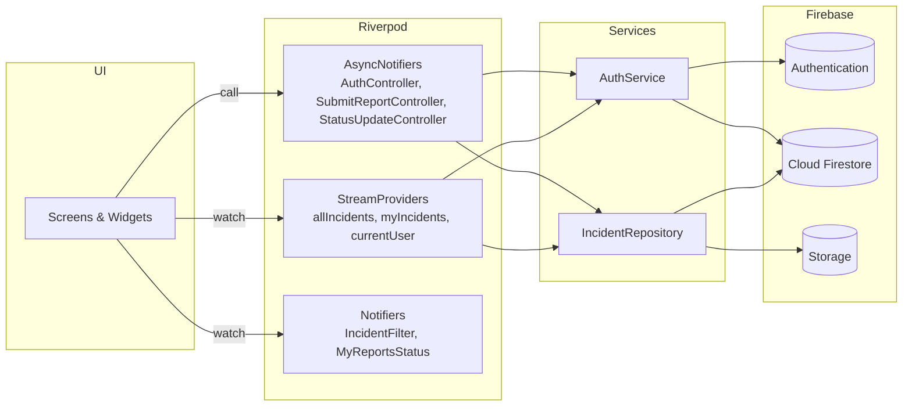
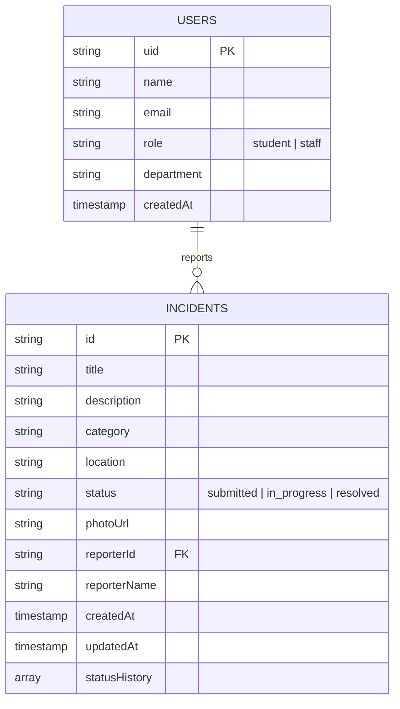

# Technical report outline (StudentName_Assignment2.pdf)

Use this as the skeleton for the PDF. Each heading matches a rubric item in
the assignment brief. Replace the bracketed prompts with your own text and
screenshots; keep IEEE or APA citations for Flutter, Riverpod and Firebase
documentation.

## 1. Introduction
[Problem: slow, informal reporting of campus issues. Goal: one channel for
students to report and track, and for staff to triage.]

## 2. Application architecture
Three layers: UI -> Riverpod providers/controllers -> services -> Firebase.

[Explain why: testability (providers can be overridden), single source of
truth, screens free of Firebase code. Reference `lib/providers/*`.]

## 3. Firebase data structure
[Paste the `users` and `incidents` schema from README section 2. Explain the
denormalised `reporterName`, server timestamps, the `statusHistory` audit
array, and the Storage path `incidents/{uid}/{file}`.]

## 4. State management approach
[Riverpod chosen over Provider/BLoC: compile-safe, no BuildContext, easy
derived state (`filteredIncidentsProvider = filter x allIncidents`), built-in
AsyncValue for loading/error. Describe the three provider kinds used and where
`setState` is still used (ephemeral UI only).]

## 5. User roles and access control
[Role stored in `users/{uid}.role`; set to student at sign-up; promoted by an
administrator in the console. UI gating via `isStaffProvider`; server-side
gating via `firestore.rules` (`isStaff()`, `affectedKeys().hasOnly`). Include
the rules snippet and a screenshot of a denied write if you test it.]

## 6. UI/UX decisions
[Design system: purple primary, card-based lists, status colour coding
(amber / blue / green), bottom bar with a central Report action, category
grid with icons, timeline on detail page, empty/error/loading states,
pull-to-refresh, relative timestamps, inline validation messages, image
compression before upload.]

Workflows to screenshot: sign-up validation, home, report form (filled),
photo picked, detail with timeline, browse with filters, staff update sheet,
student view after staff update, My Reports.

## 7. Testing strategy
[Unit tests (validators, time formatting, filter logic, model round trip),
widget tests (chip, card, timeline), manual end-to-end matrix with two
accounts on an emulator, security-rules checks. Mention CI workflow.]

## 8. Challenges encountered
[Examples you can expand on: serverTimestamp cannot be used inside
`arrayUnion` (device time used in history, server time on document);
`where + orderBy` needing a composite index (solved by sorting on device);
route stack after sign-up (pop back to AuthGate); image size limits; keeping
rules and client validation in sync.]

## 9. Lessons learned
[...]

## 10. Links
- GitHub repository: <...>
- Demo video (7-10 min): <...>

## References
[Flutter docs, Riverpod docs, Firebase Auth / Firestore / Storage docs,
image_picker package - in APA or IEEE format.]
